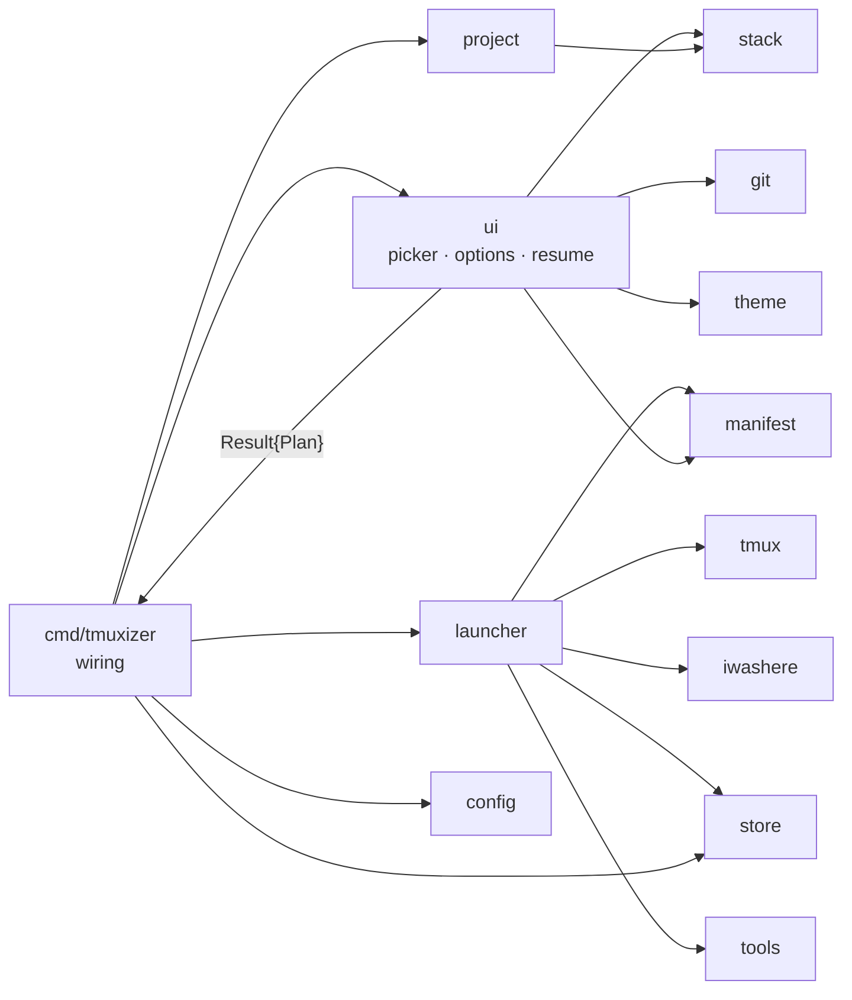

# Architecture

tmuxizer is a thin orchestrator. It owns three things: finding and understanding projects, a [Bubble Tea](https://github.com/charmbracelet/bubbletea) UI to choose one, and a launcher that turns the choice into a tmux session. Everything else ([tmux](https://github.com/tmux/tmux), [iwashere](https://github.com/Murchoid/iwashere), git) is a CLI it shells out to.

## Flow



The UI never starts processes that change anything. It returns a `Result` (quit, shell here, or launch with a `Plan`) and `main` hands the plan to the launcher. This keeps the UI testable with plain key presses.

## Packages

| Package | Responsibility | Depends on |
| --- | --- | --- |
| `cmd/tmuxizer` | Argument handling, dependency wiring, `init` snippets, the hidden `_closed` hook command | everything |
| `config` | Reads `~/.config/tmuxizer/config.toml`, XDG paths, defaults | none |
| `stack` | Detects language, package manager, framework, scripts and the predicted run command | none |
| `project` | Finds projects under the configured roots; `Containing` resolves the project around the cwd | `stack` |
| `store` | `state.json`: recents, remembered launch choices, project cache, live sessions. Locked and atomic | none |
| `tmux` | Thin client over the `tmux` binary with an injectable runner | none |
| `tools` | Detects installed editors and agents from `PATH` | none |
| `iwashere` | Drives the iwashere CLI; reads its session JSON directly | none |
| `launcher` | Builds a session from a `Plan`, closes sessions, installs the close hook, finds orphans | `tmux`, `iwashere`, `store`, `project`, `tools`, `manifest` |
| `manifest` | Reads and validates a project's `.tmuxizer.toml` (pinned run, editor, agents, layout, extra windows) | none |
| `git` | `git status --porcelain=v2` and the last commit | none |
| `report` | Totals iwashere time per project for today, this week or all time | `iwashere`, `project` |
| `setup` | `tmuxizer setup`: starter config, shell hook (atomic, symlink-safe, marked block), optional iwashere build | `tools` |
| `doctor` | Read-only environment checks with an injectable `Env` | `config`, `setup`, `tools` |
| `update` | Pull, rebuild and atomically replace the binary, or `go install` | none |
| `theme` | ANSI-palette styles | `stack` |
| `ui` | Picker, live strip, launch options, resume prompt | `launcher`, `stack`, `store`, `git`, `theme`, `tools`, `iwashere`, `manifest` |

`setup`, `doctor`, `update` and `report` back CLI commands rather than the TUI. They take every side effect (commands, `LookPath`, file locations) as a field, so tests run without tmux, git or a network.

Rule: leaf packages (`stack`, `tmux`, `tools`, `iwashere`, `git`, `store`, `config`, `manifest`) never import each other. Only `launcher`, `ui` and `main` compose them.

## Opening a project

```
picker (enter)
  └─ live session already? ──yes──▶ attach
  └─ no ─▶ options screen (run · editor · agents · iwashere)
            └─ enter ─▶ Result{Launch, Plan}
                          └─ launcher.Launch
                               1. pick a session name (reuse if same path)
                               2. read .tmuxizer.toml (invalid = abort before touching tmux)
                               3. new-session  "term"
                               4. app: window "app", or a side pane in "term" when layout = split
                               5. extra windows from the manifest
                               6. editor / agents           (terminal tools get a window, GUI tools are detached)
                               7. select-window "term"
                               8. install session-closed hook
                               9. iwashere init + session start
                              10. save recents, choices and the session to state.json
                              11. attach, or switch-client when already inside tmux

Closing from the picker (`x`) runs `launcher.Close`: kill the tmux session, then the same cleanup the hook performs. Running both is safe.

Choices resolve in this order: **manifest pin**, then the **remembered choice**, then **detection**.
```

The first window is `term` and it is the one focused, so you land in a free shell with the app running one window over.

## Session lifecycle

```
launch ──▶ state.sessions[name] written
              │
   close tmux session ──▶ tmux hook ──▶ tmuxizer _closed <name>
              │                              ├─ iwashere session end
              │                              └─ state.sessions[name] removed
              │
   power loss / kill-server (hook never runs)
              ▼
   next start: state has a session with no live tmux session = orphan
              ▼
   resume prompt:  r resume  ·  n start new  ·  d dismiss  ·  s skip
```

- **resume** rebuilds the windows from the saved choices and continues the iwashere session.
- **start new** ends the old iwashere session, then launches fresh.
- **dismiss** ends the old iwashere session and forgets it.

## Data on disk

| Path | Written by | Contents |
| --- | --- | --- |
| `~/.config/tmuxizer/config.toml` | you, or `tmuxizer setup` (only when missing) | roots, depth, ignore, editor, accent, session_name |
| `~/.zshrc`, `.bashrc`, `config.fish` | `tmuxizer setup` (asks first) | one block between `# >>> tmuxizer >>>` and `# <<< tmuxizer <<<` |
| `~/.local/state/tmuxizer/state.json` | tmuxizer | recents, per-project choices, project cache, live sessions |
| `<project>/.iwashere/` | iwashere | sessions and notes; tmuxizer only reads `sessions/*.json` |

## Design decisions

- **ANSI palette only.** Styles use colours 0-15 and never paint a background, so the terminal's theme drives the look. No RGB anywhere.
- **Instant start.** The picker renders from the cached project list, then rescans in the background and swaps the list in, keeping the cursor on the same project.
- **Async git.** Branch and dirty state load only for the selected project, once.
- **Matching is fuzzy on names, substring on paths.** Fuzzy matching a long path matches nearly everything; name matches carry positions so the row can underline them.
- **Typed keys can arrive as one message.** Bubble Tea delivers fast input like `jj` as a single multi-rune key; the model splits it back into single keys unless the filter input is focused or it is a paste.
- **Detection never fails.** `stack.Detect` returns what it found; unreadable files and broken manifests just yield less.
- **iwashere failures never block launch.** Tracking is best effort.
- **The hook runs in the foreground.** A background `run-shell` job is lost when the last session closes and tmux exits.
- **The hook has its own array index** (`session-closed[742]`), so it does not replace hooks you already configured.
- **Sessions are reused by path.** A name collision with another directory gets a longer name instead of attaching to the wrong project.

## Testing

Pure logic is table tested (`stack`, `project`, `store`, `config`, `git`). `launcher` and `iwashere` take injected runners, so tests check exact tmux and CLI calls without a server. `ui` is tested by sending key messages to the model.

For manual tmux testing, use an explicit socket and clear `$TMUX`:

```sh
env -u TMUX tmux -S /tmp/tz.sock new-session -d ...
```

Never run `tmux kill-server` without `-S`; inside tmux, `$TMUX` overrides `TMUX_TMPDIR` and the command hits your real server.

## Ideas

- Per-project split ratios and multi-pane layouts in the manifest.
- A themed splash on first run, and project icons.
- `tmuxizer doctor` to report missing tmux, iwashere and editors.
- Session activity (last output, running command) in the live strip.
- Trust prompt the first time a project's manifest adds windows.
